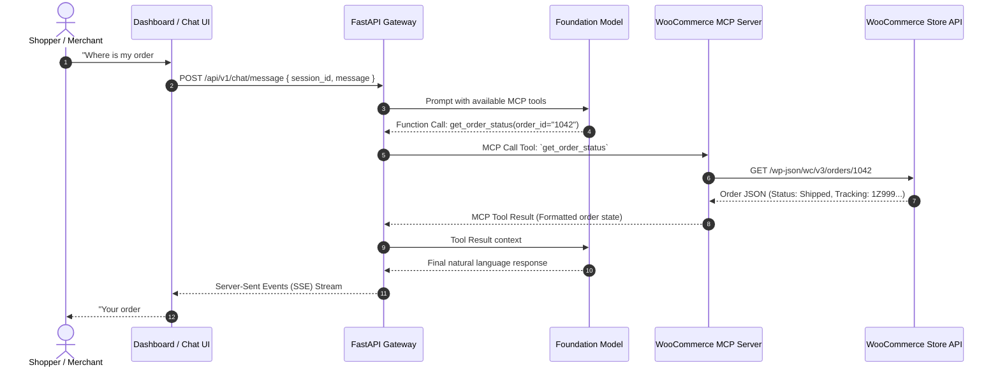

# Urumi AI Platform - Architecture Overview

## 1. System Vision & Objective
The Urumi AI Platform is an enterprise-grade AI Forward Deployed Engineering (FDE) system designed to seamlessly bridge conversational AI agents with e-commerce operations (starting with WooCommerce) via the Model Context Protocol (MCP).

The system empowers merchants and customer service agents with real-time semantic product discovery, intelligent order management, inventory queries, and automated customer assistance workflows.

---

## 2. High-Level Architecture Diagram

```mermaid
flowchart TB
    subgraph ClientLayer ["Client Layer"]
        Dashboard["React + Vite Merchant Dashboard"]
        ShopperUI["Consumer Chat Widget / Embed"]
    end

    subgraph IngressLayer ["Ingress & Gateway Layer"]
        Ingress["Kubernetes Ingress (Nginx / Traefik)"]
        Gateway["FastAPI Gateway & Agent Orchestrator"]
    end

    subgraph AgentCore ["Agent & Intelligence Layer"]
        LLM["LLM Provider (Claude / OpenAI / Gemini)"]
        AgentEngine["LangGraph / Custom Agent Orchestrator"]
        SessionStore[("Redis Session & State Store")]
    end

    subgraph MCPLayer ["Model Context Protocol (MCP) Mesh"]
        MCPClient["MCP Host Client (Async SSE / Stream)"]
        MCPServer["WooCommerce MCP Server (Python MCP SDK)"]
    end

    subgraph ExternalIntegration ["External Systems"]
        WooCommerceAPI["WooCommerce REST API / Storefront"]
        MySQL[("WooCommerce MySQL DB / WP Webhooks")]
    end

    Dashboard -->|REST / WS| Ingress
    ShopperUI -->|REST / WS| Ingress
    Ingress --> Gateway
    Gateway --> AgentEngine
    AgentEngine --> LLM
    AgentEngine --> SessionStore
    AgentEngine --> MCPClient
    MCPClient <-->|MCP Protocol (SSE / Stdio)| MCPServer
    MCPServer <-->|Encrypted REST v3| WooCommerceAPI
    WooCommerceAPI <--> MySQL
```

---

## 3. Core Component Breakdown

### 3.1. Merchant Dashboard (`/dashboard`)
- **Technology Stack**: React 18, Vite, TypeScript, Tailwind CSS / Vanilla CSS design tokens.
- **Responsibilities**:
  - Live agent chat & trace visualization (inspect tool executions & reasoning).
  - Store connection configuration (WooCommerce API credentials, webhook endpoints).
  - MCP Server health monitor & tool catalog inspector.
  - Analytics on shopper inquiries, tool usage frequency, and order conversion stats.

### 3.2. API Gateway & Agent Orchestrator (`/gateway`)
- **Technology Stack**: FastAPI, Python 3.11+, Pydantic v2, Uvicorn, Asyncio.
- **Responsibilities**:
  - Expose authenticated REST and WebSocket endpoints for streaming agent responses.
  - Manage session state and memory buffers via Redis.
  - Act as the **MCP Host/Client**, connecting to downstream MCP servers.
  - Execute tool-calling loop: prompts LLM, routes tool invocations to the WooCommerce MCP Server, and streams final synthesized responses back to clients.
  - Security, rate limiting, and structured JSON logging.

### 3.3. WooCommerce MCP Server (`/mcp-servers/woocommerce`)
- **Technology Stack**: Official Python MCP SDK (`mcp`), FastMCP / low-level server primitives, HTTPX, Pydantic.
- **Responsibilities**:
  - Expose standardized MCP Tools (e.g., `search_products`, `get_order_status`, `check_inventory`, `create_draft_order`, `get_customer_history`).
  - Expose MCP Resources (e.g., store catalog schema, store policy documents).
  - Expose MCP Prompts for standard e-commerce assistance templates.
  - Handle rate limiting, backoff, and authentication with WooCommerce REST API (HMAC-SHA256 / Basic Auth).

### 3.4. Deployment & Infrastructure (`/helm`, `/deploy`)
- **Technology Stack**: Helm 3, Kubernetes, Docker, Multi-stage builds.
- **Components**:
  - Helm Umbrella Chart (`helm/urumi-platform`) containing deployments, services, ConfigMaps, Secrets, Ingress, and HPA (Horizontal Pod Autoscaler) rules.
  - Docker Compose for zero-friction local development and integration testing.

---

## 4. Communication Protocols & Data Flow

### 4.1. Conversational Tool Execution Flow


---

## 5. Security & Multi-Tenancy Strategy
1. **Credential Isolation**: WooCommerce consumer keys and secrets are stored in Kubernetes Secrets / HashiCorp Vault, encrypted at rest.
2. **Transport Security**: Mutual TLS between internal services; HTTPS/WSS at the ingress layer.
3. **Guardrails & Permission Scopes**: MCP Tools are gated by read-only vs. read-write permissions (e.g., refunds or order modifications require merchant approval tokens).
4. **Rate Limiting & Circuit Breaking**: Resilience policies on the WooCommerce REST client to avoid overloading store instances during high-traffic spikes.
