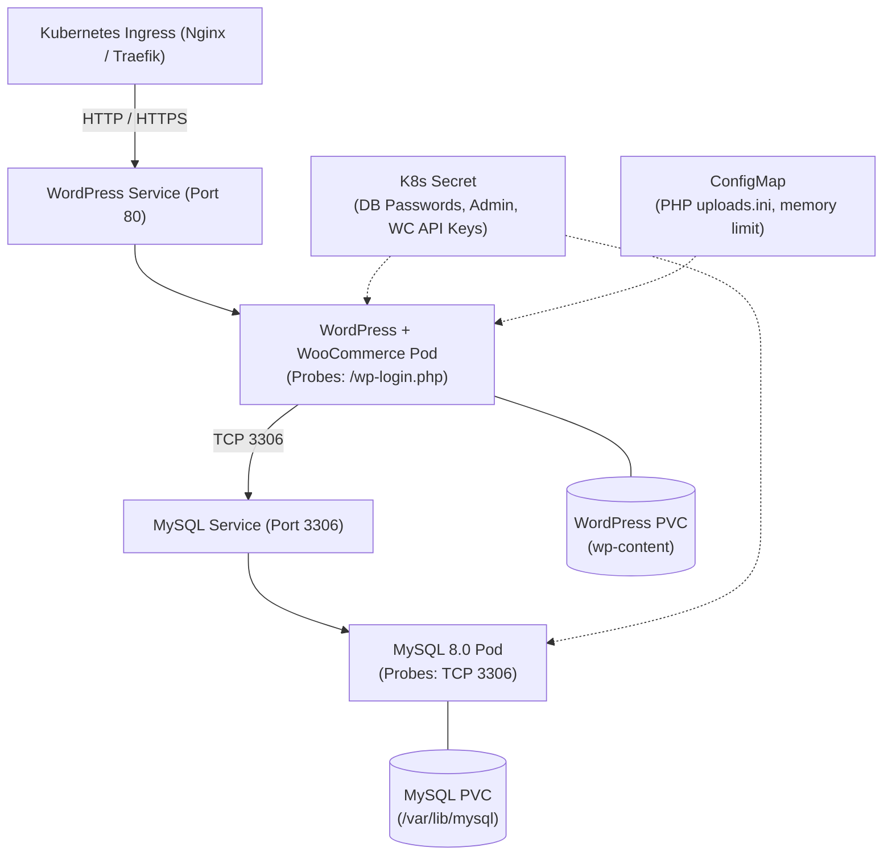

# WooCommerce Kubernetes Deployment Guide

This guide details how to deploy the WooCommerce & WordPress stack on Kubernetes using the `woocommerce` Helm chart.

---

## 🏗 Architecture Components



---

## ⚙️ Key Configuration Files

| File | Purpose |
|---|---|
| [`Chart.yaml`](file:///c:/Users/rayin/OneDrive/Desktop/Urumi/helm/woocommerce/Chart.yaml) | Chart metadata and versioning |
| [`values.yaml`](file:///c:/Users/rayin/OneDrive/Desktop/Urumi/helm/woocommerce/values.yaml) | Base chart default parameters |
| [`values-local.yaml`](file:///c:/Users/rayin/OneDrive/Desktop/Urumi/helm/woocommerce/values-local.yaml) | Local dev environment profile (Minikube / Docker Desktop / Kind) |
| [`values-prod.yaml`](file:///c:/Users/rayin/OneDrive/Desktop/Urumi/helm/woocommerce/values-prod.yaml) | Production environment profile (EKS / GKE / AKS / TLS Ingress / gp3) |

---

## 🚀 Deployment Instructions

### 1. Local Development Deployment (Minikube / Kind / K3d)

```bash
# 1. Ensure local ingress addon is enabled (for Minikube)
minikube addons enable ingress

# 2. Add local DNS mapping to /etc/hosts (or C:\Windows\System32\drivers\etc\hosts)
# 127.0.0.1  store.local

# 3. Deploy chart with local values
helm install urumi-store ./helm/woocommerce -f ./helm/woocommerce/values-local.yaml
```

### 2. Production Deployment (EKS / GKE / AKS)

```bash
# 1. Create production namespace
kubectl create namespace urumi-ecommerce

# 2. (Optional) Create pre-existing production secret with external secret manager
kubectl create secret generic urumi-store-production-secrets \
  --from-literal=mysql-root-password="<STRONG_ROOT_PWD>" \
  --from-literal=mysql-database="wordpress_prod" \
  --from-literal=mysql-user="wp_prod" \
  --from-literal=mysql-password="<STRONG_WP_DB_PWD>" \
  --from-literal=wordpress-admin-user="urumi_admin" \
  --from-literal=wordpress-admin-password="<STRONG_ADMIN_PWD>" \
  --from-literal=wordpress-admin-email="admin@urumi.ai" \
  --from-literal=woocommerce-consumer-key="<CK_KEY>" \
  --from-literal=woocommerce-consumer-secret="<CS_SECRET>" \
  -n urumi-ecommerce

# 3. Install or upgrade chart
helm upgrade --install urumi-store ./helm/woocommerce \
  -f ./helm/woocommerce/values-prod.yaml \
  --namespace urumi-ecommerce
```

---

## 🔍 Health Probes & Resource Management

### Readiness & Liveness Checks
- **WordPress**:
  - `livenessProbe`: HTTP GET on `/wp-login.php` (detects PHP-FPM or Apache process lockups).
  - `readinessProbe`: HTTP GET on `/wp-login.php` (ensures traffic is only routed after the container is accepting HTTP requests).
- **MySQL**:
  - `livenessProbe`: `tcpSocket` on port 3306.
  - `readinessProbe`: `tcpSocket` on port 3306.

### Storage & Persistence
- **WordPress (`/var/www/html/wp-content`)**: Persists plugins (including WooCommerce), themes, media library uploads, and cache.
- **MySQL (`/var/lib/mysql`)**: Persists all transactional catalog, order, and customer state across pod restarts.
